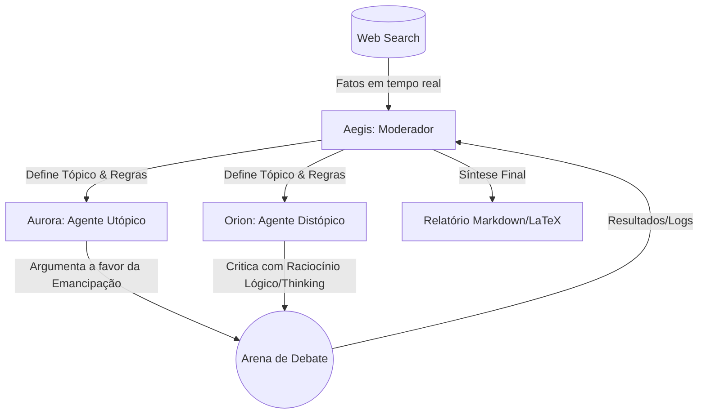

# Arena Git Repo - Atividade 3

Este diretório contém a estrutura isolada para a execução da arena dialética via CLI (Antgravity / Gemini CLI).

## Diagrama de Papéis e Fluxo

O protocolo de comunicação segue um formato de turnos com injeção de fatos externos.

## Responsabilidades
- **Moderador (Aegis):** Orquestra o debate, pesquisa dados macroeconômicos recentes e avalia quem apresentou os melhores dados de qualidade.
- **Utópico (Aurora):** Promove soluções criativas, foca em transição de carreira, Renda Básica Universal (UBI) e a economia do tempo livre.
- **Distópico (Orion):** Focado em análise de falhas sistêmicas, concentração de capital, hipervigilância corporativa e perda de propósito humano. Utiliza processo de *thinking/reasoning* para estruturar falhas nas propostas utópicas.
